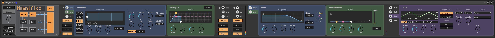
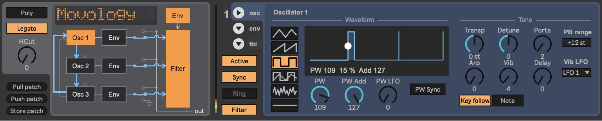
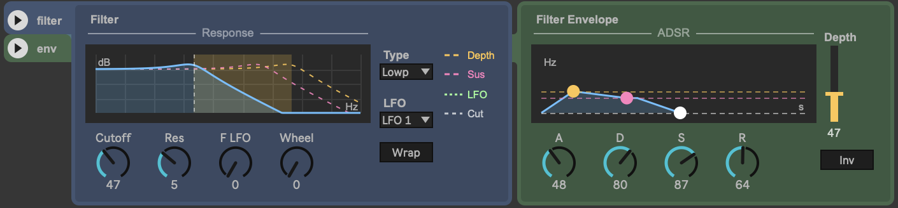
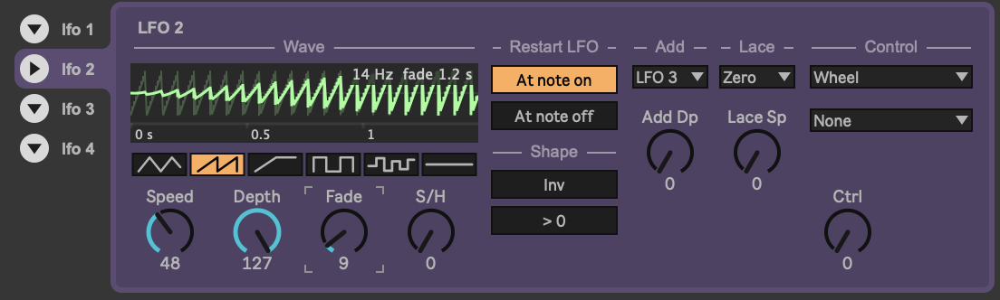

# SidStation Editor

A Max for Live editor for the **Elektron SidStation**, the MOS 6581 (SID) synthesizer from 1999.
Every sound parameter of a patch is on screen and automatable in Ableton Live: three oscillators
with envelopes, pulse width and wave tables, the filter with its envelope, four LFOs, and the
patch-wide settings.



Not affiliated with or endorsed by Elektron. Use at your own risk.

## Features

- **Overview** after the SID datasheet's block diagram: oscillators, envelopes, the filter
  routing switches, sync and ring arrows, the patch name in the synth's dot-matrix style.
- **Oscillators:** waveform, pulse width with its LFO and sync, envelope (ADSR drawn and draggable),
  vibrato, portamento, transpose, arpeggio.
- **Waveform tables** (the manual's *Tabl*, the trick behind Rob Hubbard's sounds and the C64's
  drums): one per oscillator, edited as a step sequencer with waveform, sync, ring and a fixed or
  relative note per step, played once or looped, at the table's own speed. Pull and Push keep a
  table exactly as the synth stores it.
- **Filter:** cutoff, resonance, type, envelope with invert, LFO depth, a live frequency-response
  picture.
- **LFOs 1–4:** type, speed, depth, fade-in, sample & hold, note-on/off sync, with a curve view.
- **Osc 3 "Mod only"** (the SID's 3OFF): oscillator 3 keeps running for sync and ring modulation
  without being heard.
- **Push patch** sends the whole editor state to the synth's edit buffer.
- **CC 119** (value above 0) on the track, from a clip or a controller button, pushes the patch too,
  at most once every 5 seconds. Put it at the start of a song so the synth plays what the editor
  shows. The editor keeps CC 119 to itself; it never reaches the synth.
- Loading a Live Set or the device sends nothing to the synth.
- **Pull patch / Store patch** and the settings request need a firmware with dump-request and
  store support (see below). With the stock OS the synth does not answer, and the editor shows
  **NO REPLY**.
- Every value is a Live parameter: automation, MIDI mapping and presets work as usual.
- **Patch Action** is a Live parameter (not on screen) with the choices None, Pull patch, Push patch
  and Store patch: setting it from automation, a MIDI mapping or Live's API does that action and
  returns it to None. Map a button to it, not a knob: a knob sweeping through the choices does all
  three.
- Every parameter has a help text in Live's Info View, also those with no control on screen, and
  the device description tells a program driving the editor through Live's API how to behave:
  edits reach the synth at once, and Pull, Push and Store patch are never chosen unless asked.
- **Push 2:** every parameter in banks, and the waveform tables edited step by step (see Push below).
- **"(using waveform table)"** after an oscillator's title shows that the table, not the Wave switch, sets
  its waveform. The Info View explains, and holding the mouse over the note points out the table.







## Requirements

- Ableton Live 12 with Max for Live (Max 9, the `v8` objects).
- A SidStation. Pull, Store and the settings request need OS 1.12 R01
  ([sidstation-firmware](https://github.com/norrby/sidstation-firmware)); everything else uses only
  what the manual describes and has been tested with OS 1.10 R33.
- **Not OS 1.11 R34:** its direct-parameter receiver is broken and writes outside the edit buffer,
  which can damage stored patches.
- A MIDI interface connected both ways to the synth (MIDI Out → synth In, synth Out → MIDI In).

## Install

1. Download `SidStation-Editor-<version>.amxd` from the latest release on the
   [Releases](https://github.com/norrby/sidstation-editor/releases) page. It is a single frozen file:
   the scripts and icons are inside.
2. Put it in your User Library, for example `User Library/Presets/MIDI Effects/Max MIDI Effect/`, or
   drag it straight from the download folder.
3. Drag **SidStation Editor** onto a MIDI track.

### From source

1. Clone this repository and run `npm run build` (Node 24 or later). This writes `dist/`.
2. In Live's browser, **Places → Add Folder…** and pick the `dist/` folder.
3. Drag **SidStation Editor** onto a MIDI track.

The device loads its scripts from `dist/`, so keep the folder where it is. After a change in the
sources, run `npm run build` again: Live reloads the scripts by itself, and the device itself when
its `.amxd` has changed.

## Setup in Live

One MIDI track does everything:

- **Devices:** `SidStation Editor`, then Live's **External Instrument** with *MIDI To* = the synth's port.
- **MIDI From:** a port that hears the synth's **MIDI Out** (the interface's input, or *All Ins*).
  It must never hear the track's own output through a loop.
- **Monitor:** *Auto*, track armed: the keyboard, the track's clips and the synth's replies all reach
  the editor. (*In* silences the clips.)
- In Live's MIDI settings, keep *Remote* off for the synth's ports: with it on, Live itself sends
  mapped values to the synth.

If the synth's MIDI In light blinks but replies never reach the editor, Live may have lost the
input port: restart Live.

## Push

With a Push 2 (or 3) the device shows its parameters in banks: **Main** (filter and the three
oscillators' waveforms), **Patch**, **Filter**, **Filter Env**, four per oscillator (**Osc1**, **Osc1 Env**,
**Osc1 Mod**, **Osc1 Table**) and two per LFO. The one-shot buttons (Push, Pull and Store patch) are kept
off Push, so a stray touch never sends or stores a patch. The patch name is the device name in Push's
header.

**Osc1 Table** edits oscillator 1's waveform table on Push, one step at a time, with what you do
appearing in the table on screen and going to the synth as a click there would:

| Knob | |
|---|---|
| **Step** | the step being edited; it stops at the table's last step |
| **Wave** | Tri, Saw, Pulse, Mix, Noise, Off, or Keep (the waveform stays as it was) |
| **Mod** | None, Sync, Ring or S+R |
| **Pitch** | Keep, Fixed or Relative; the next knob follows: |
| **Note** / **Offset** | the fixed note, or the offset in semitones |
| **Length** | the number of steps, 0–65 |
| **Loop** | Once or Loop; switching to Loop loops to the last step and shows **Loop To** in the next slot until another knob is turned |
| **Speed** / **Loop To** | the table's speed (0 = off), or the step the loop goes back to |

## Safety

The SidStation's OS lives in flash memory, and wrong SysEx can damage it. The editor therefore
sends to the synth only through one gateway (`max/sid.send.js`):

- Patch frames, direct-parameter frames and requests are validated byte by byte; parameter
  frames must also match a whitelist of the documented parameter rows.
- One queue, one message at a time; nothing else goes out while the synth stores a patch.
- Incoming SysEx is never passed on. A frame of a kind only the editor sends that comes back in is
  reported as a loop.
- OS update frames can never pass.

## Data folders

Max cannot create folders, so these are used only if you create them in your home folder:

| Folder | What |
|---|---|
| `Documents/SidStation/dumps` | every patch dump received is saved here as `.syx` |
| `Library/Logs/SidStation` (macOS), `Documents/SidStation/logs` (Windows) | `max.log`, a log for troubleshooting (everything also goes to the Max console) |

On Windows the home folder is `C:\Users\<name>`; this has not been tried on Windows yet.

## Firmware

Pull, Store and the settings request use SysEx messages (ids 05, 06 and 07) that the stock
SidStation OS does not know; they need OS 1.12 R01, a patch for OS 1.10 R33:
[sidstation-firmware](https://github.com/norrby/sidstation-firmware). Everything else works with
the stock OS 1.10.

## Command line

```
node tools/validate-bank.js bank.syx [--clean out.syx]   # check a .syx bank before sending it
node tools/sid.js cc 42 127                               # control the editor in Live over UDP 9871
node tools/sid.js request 127                             # dump request (needs the modified firmware)
```

## Development

How the device works, from the big picture down: [docs/architecture.md](docs/architecture.md). Where to start
reading the code: [docs/reading-guide.md](docs/reading-guide.md).

```
npm run build    # generates dist/ (devices + bundled scripts) from build/, lib/ and max/
npm test
```

| Directory | Contents |
|---|---|
| `lib/` | plain JavaScript shared by Node and Max: SysEx, parameters, layout, MIDI parser, palette, help texts |
| `max/` | the scripts that run in Max (`v8` and `v8ui`) |
| `build/` | generators for the `.amxd` devices |
| `dist/` | generated by `npm run build`; what Live loads |
| `test/` | `node --test` |
| `tools/` | command-line tools |

Node 24 or later.

Why a build step: the device is not drawn in Max but described in `build/`, which places every
control and writes the `.amxd`. Each `v8` object in Max loads one file, so the build joins the
shared code in `lib/` (the parameter table, the SysEx checks, the MIDI parser) with each script in
`max/`; the tests run the same `lib/` files in Node. The layout, the Push banks and the help texts
are computed by the build as well. `npm run release` builds and freezes the device into one file
in `release/`.

## License

Copyright (C) 2026 M Norrby

This program is free software: you can redistribute it and/or modify it under the terms of the
GNU General Public License as published by the Free Software Foundation, either version 3 of the
License, or (at your option) any later version. See [LICENSE](LICENSE).
