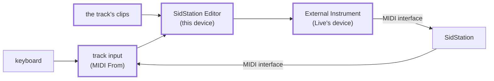
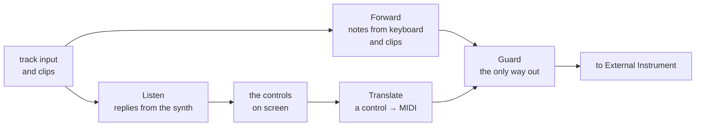
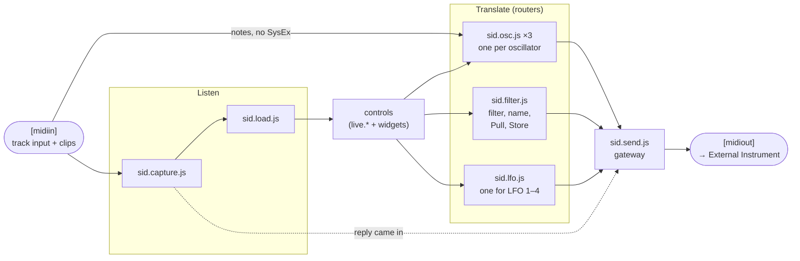
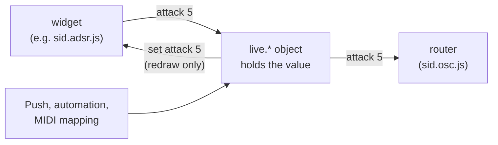
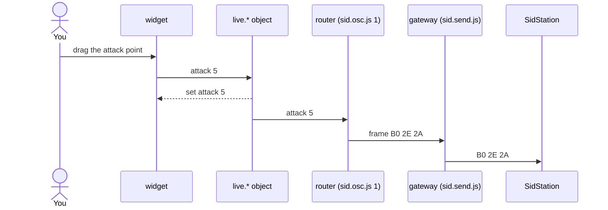
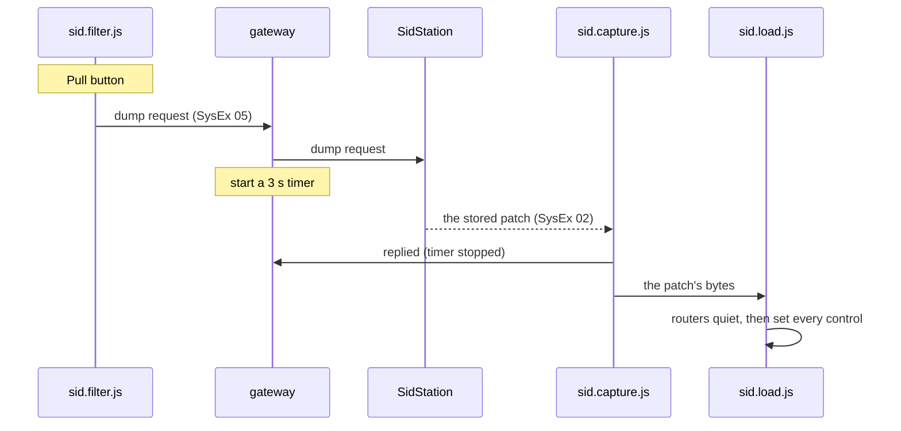
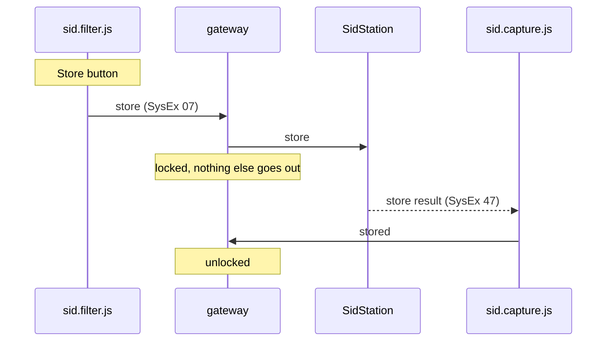
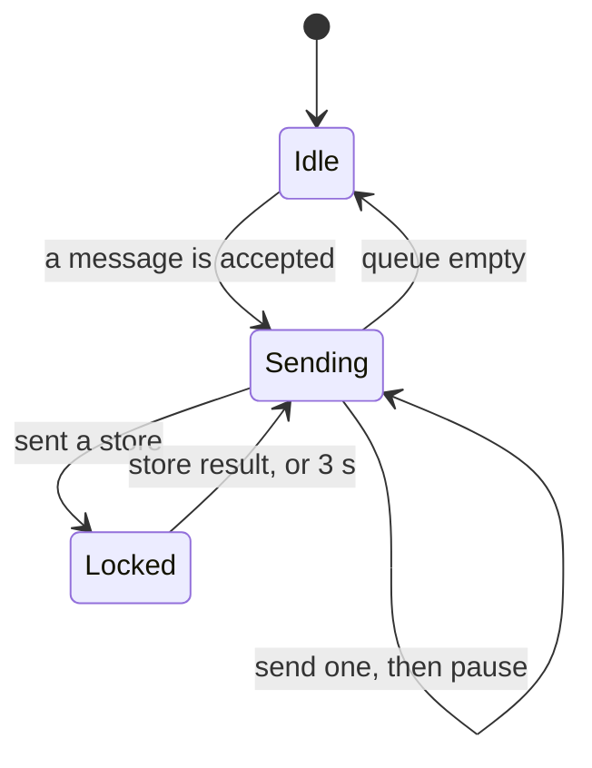
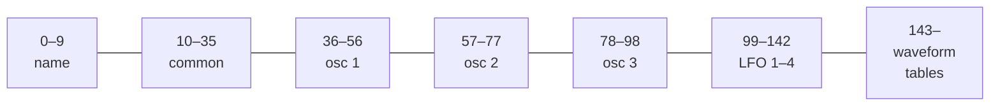
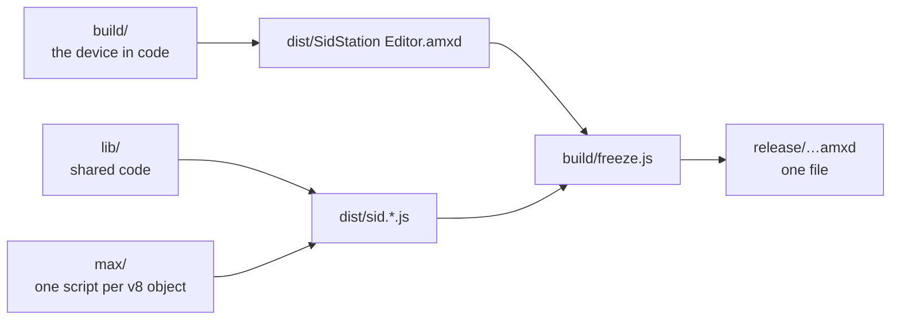

# Architecture

This document starts with the big picture and adds detail one layer at a time. The stories behind the safety rules
are collected at the end.

## 1. The big picture

Six things take part: the **SidStation**, a **MIDI interface**, and, on **one MIDI track in Ableton Live**, the
track's **input**, the track's **clips**, this **editor** device and Live's own **External Instrument** device.

- **The track's input** (*MIDI From* in Live) hears the MIDI interface: the synth's replies, and also your keyboard.
- **The track's clips** are not part of the input, but Live merges what they play with the input before it reaches
  the first device. The editor gets both as one MIDI stream.
- **The editor** is a Max for Live device. On screen it has **controls**: dials, buttons, menus and drawn editors
  such as the envelope, one for every value in a SidStation patch (section 4 shows how they are made). The editor
  turns a change of a control into MIDI messages, and sets the controls from what the synth sends back.
- **External Instrument** comes after the editor on the same track. It sends the editor's output to the MIDI
  interface (*MIDI To*).
- **The MIDI interface** is wired both ways: its output to the synth's MIDI In, the synth's MIDI Out to its input.

So one track both sends to the synth and hears what the synth sends back, and no second track is needed for the
replies.

The boxes with a thick border are on the same Live track.

## 2. The device's four jobs

Between the track's input and External Instrument, the device does four jobs: **Translate**, **Guard**, **Listen**
and **Forward**.

- **Translate:** when a control on screen changes, a *router* script turns it into a MIDI message.
- **Guard:** every message bound for the synth passes one script, the *gateway*. It checks each message, sends one
  at a time, and is the only part of the device connected to the output.
- **Listen:** a *capture* script reads what comes in from the synth (a patch, a reply) and sets the controls from it.
- **Forward:** notes have to reach the synth too, whether you play them on a keyboard or a clip on the track plays
  them. The device passes them from its input to its output.

Everything coming in, from the track's input and its clips, goes to two places at once: to Listen and to Forward. The Forward path passes channel messages (notes, pitch
bend, CC) and **drops all SysEx**. SysEx coming in is the synth talking: patch dumps and replies. Sent back to the
synth, a patch dump would overwrite its memory. That is why messages from the synth only ever go to Listen.

## 3. The four jobs as scripts

Each job is done by one or more scripts in `max/`, and each script runs as a `[v8]` object in the device:

| Job | Scripts |
|---|---|
| Translate | the routers: `sid.osc.js` (three copies, one per oscillator), `sid.filter.js` (filter, patch name, Pull, Store), `sid.lfo.js` (one copy for all four LFOs) |
| Guard | the gateway: `sid.send.js` |
| Listen | `sid.capture.js` decodes what comes in, `sid.load.js` sets the controls from a patch |
| Forward | oscillator 1's router, `sid.osc.js` 1 |

Two of Max's own objects are the device's ends: `[midiin]` receives the track's input and clips, `[midiout]` leads to External
Instrument.

- **Forward in a router:** oscillator 1's router sees the track's input anyway, so it also passes the notes on to the
  gateway. The other routers do not see the input.
- **Listen tells Guard:** when a reply arrives, the capture also tells the gateway, so the gateway can stop waiting
  for it (the dotted line below).
- **One way out:** the gateway is the only script connected to `[midiout]`.

## 4. The controls: Live parameters and widgets

A control on screen has up to two parts: a **Live parameter** that holds the value, and sometimes a **widget** that
draws it.

- **Live parameter:** a `live.*` object such as `live.dial`, `live.tab` or `live.toggle`. Automation, MIDI mapping,
  presets and Push all work on these objects.
- **Widget:** a control drawn by our own script (`v8ui`): the envelope, the pulse width, the waveform table, the name
  display. A widget is always paired with a hidden `live.*` object.

The `live.*` object is the source of truth. The widget only draws it and writes to it. The router listens to the
`live.*` object, not to the widget, so a knob on Push takes the same path to the synth as a drag in the widget.

## 5. One control change, all the way to the synth

The path passes the widget, the `live.*` object, the router and the gateway. Example: you drag oscillator 1's attack
from 0 to 5.

- **The router** looks the parameter up in the table in `lib/params.js`. Attack has CC offset 12, and oscillator 1's
  CCs start at 34, which gives CC 46 (hex 2E). The value 5 of 0–15 scaled to 0–127 is 42 (hex 2A). `B0` means
  "control change on channel 1", so the message is `B0 2E 2A`.
- **CC or Direct Program:** CC is ordinary MIDI. Some parameters have no CC, or a range the CC can't carry
  exactly; those go as *Direct Program*, a SysEx message the SidStation manual documents for writing one field of
  the patch.
- **The gateway** checks the message and puts it in its queue (section 7).

## 6. Pull and Store

**Pull** fetches the patch the synth has stored; **Store** saves the synth's current sound in its current slot. Both
need our firmware patch, OS 1.12 R01 ([sidstation-firmware](https://github.com/norrby/sidstation-firmware)). With
the stock OS the synth does not answer, and after 3 seconds the name display shows **NO REPLY**.

### Pull

Pull involves the filter router (`sid.filter.js`, which owns the Pull button), the gateway, the synth, the capture
and the loader (`sid.load.js`). The router sends a *dump request*, and the gateway starts a 3-second timer. The synth
answers with its stored patch, and the capture stops the timer and hands the patch to the loader.

The loader first tells every router to be **quiet**, and then sets the controls. Otherwise every control that
changes would send its new value back to the synth, which already has it.

### Store

Store involves the filter router, the gateway, the synth and the capture. The new idea here is the gateway's
**lock**. While the synth stores, it reorganizes its patch memory, and a patch message arriving in that moment would
damage the memory. So after sending the store request, the gateway sends nothing until the synth's *store result*
has come back, or 3 seconds have passed. Notes you play meanwhile are held and sent right after.

## 7. The gateway (sid.send.js) in detail

The gateway does three things with every message bound for the synth, in `accept()`: it checks the **shape**,
checks the **whitelist**, and puts the message in the **queue**.

1. **Shape:** bytes 0–255, SysEx starting with F0 and ending with F7, the SidStation header, a valid id.
2. **Whitelist:** a Direct Program message must write one of the fields listed in `lib/params.js`. The manual warns
   that undocumented addresses can crash the synth and destroy its memory.
3. **Queue:** one message at a time, with a pause after each: 1 ms after a channel message, 10 ms after Direct
   Program or a request, and the transfer time plus 150 ms after a patch frame, so the synth can store it.

The gateway is in one of three states: **Idle** (nothing queued), **Sending** (working through the queue) or
**Locked** (waiting for a store result). Notes skip the queue and go out at once, except while it is Locked.

## 8. The patch as bytes

A patch is a list of bytes in seven regions: the **name**, the **common** settings (filter, poly and more), the
three **oscillators**, the four **LFOs**, and the **waveform tables**. A patch dump (SysEx 02) carries this list;
`lib/sysex.js` decodes and encodes it (`decodeDump`, `encodeDump`), and `sid.load.js` reads each value at its
position.

Within an oscillator, the `dumpOff` column of `lib/params.js` gives the byte: the waveform at 15, attack at 6, and
so on.

## 9. How the device is built

The build turns three source folders into the device: **`lib/`** (shared code), **`max/`** (one script per `[v8]`
object) and **`build/`** (the device itself, described in code). It writes **`dist/`**, which is what Live loads, and
for a release **`build/freeze.js`** packs `dist/` into one file in **`release/`**.

- Nobody draws this device in Max. `build/build-station.js` (Node) creates every object and every patch cord in code
  and writes `dist/SidStation Editor.amxd`.
- Max's `[v8]` object loads exactly one file. So the build pastes the shared code from `lib/` in front of each
  script, for example `lib/sysex.js + lib/params.js + lib/midi.js + max/sid.osc.js` → `dist/sid.osc.js`.
- `npm run build` only rewrites files that changed, and Live reloads changed files by itself.
- `npm run release` also runs `build/freeze.js`, which does what Max's *Freeze Device* does.

The code runs in three places: in the **device** (Max inside Live), in the **build**, and in the **tests and
tools** (both Node).

| | Runs in | Files |
|---|---|---|
| Device | Max inside Live | `max/`, plus the parts of `lib/` pasted in |
| Build | Node | `build/`, plus `lib/layout.js`, `lib/help.js` |
| Tests, tools | Node | `test/`, `tools/`, and `lib/` and `max/` |

`lib/` contains no Max calls, which is why the same file can run in all three places.

**Layout:** at runtime, `max/sid.layout.js` places every control. When you fold a panel or pick a waveform without
pulse width, it computes the new positions with `lib/layout.js` and moves the objects. The build uses the same
code to compute the device's starting width.

## 10. Tests

`npm test` runs every `test/*.test.js` with Node's built-in test runner. Files in `lib/` are loaded directly. A
script from `max/` is loaded as text and run with small stand-ins for Max's functions (`outlet`, `Task`, `post`),
so a test can send it a message and check exactly which bytes come out. See `loadRouter` in `test/osc.test.js`.
`test/fixtures.js` builds SysEx frames by hand, without `lib/sysex.js`, so the encoder is checked against something
it didn't produce itself.

## 11. Why the safety rules exist

There are five safety rules, and each comes from something that happened, or nearly happened, while the editor was
being built.

- **SysEx from the input never goes out.** An early test device passed its MIDI input straight to its output, and the
  track sent that output back to the synth. A full patch dump from the synth starts with a "clear all patches"
  message. The echo carried that message back to the synth, and all 100 patches were erased.
- **A dump coming in is not sent back as CC.** The same echo could happen one step later: setting the controls from
  a dump would make each control send its value to the synth. So the routers are quiet while a dump is loaded.
- **Loading a Live Set sends nothing.** When Live loads the device it gives every parameter its saved value. Once
  those values went to the synth and overwrote its sound (oscillator 1 kept switching off). Now the first value
  each parameter gets is kept but never sent.
- **Nothing goes out during a store.** The synth reorganizes its memory while storing; a patch message in that
  window damages the whole memory.
- **Only whitelisted Direct Program fields.** The manual warns that other addresses can crash the synth. The OS
  itself lives in flash memory, and a SidStation's chip has had to be reprogrammed outside the synth before.
